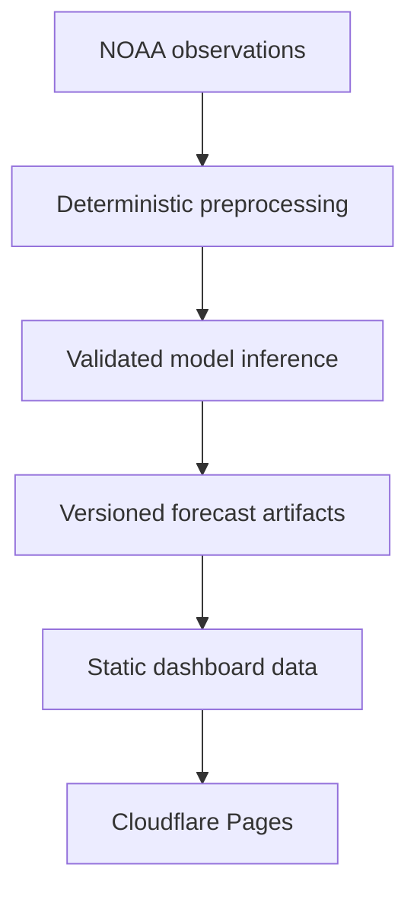

# Reef SST Forecasting and Public Risk Visualization Plan

Date: 2026-11-16

## Goal

Build a reproducible, single-region pipeline that forecasts sea surface temperature (SST) in reef-containing grid cells and publishes understandable maps of projected thermal exposure.

**Initial implementation:** validated reef-cell data processing, anomaly-persistence baselines, then leakage-free direct evaluation at daily leads 1–28. The model emits a full 28-day experimental trajectory, while publication is limited to the consecutive lead range with demonstrated held-out skill. A regional thermal-stress map follows the evaluation gate. Biological bleaching probabilities, mortality estimates, and calibrated probabilistic forecasts are not first-release deliverables.

Existing correctness findings and implementation locations are documented in [REVIEW.md](REVIEW.md).

## Current position

- The README identifies NOAA SST data and UNEP-WCMC reef polygons as the intended inputs.
- A downloaded file inspected during planning contained daily NOAA OISST on a 0.25° grid: approximately 28 km north–south. This supports regional reef-temperature estimates, not precise temperatures at individual coral colonies.
- Downloads were still progressing during inspection. Validate completed files and time coverage rather than treating partial downloads as usable data.
- No local reef-vector files or trained model/scaler artifacts were found during that inspection.
- Forecasting and DHW correctness defects must be repaired before interpreting the README's model metrics as forecasting skill.

These inventory observations are a planning-time snapshot, not a statement about subsequent downloads.

## Product definitions and limits

Keep three different outcomes separate:

1. **Thermal exposure:** reef area projected to experience elevated SST or accumulated thermal stress.
2. **Bleaching risk:** likelihood of bleaching, validated against independent field observations.
3. **Biological damage:** mortality or coral-cover loss, requiring a separately validated outcome model.

SST and DHW alone do not establish the percentage of reefs that will die. Public labels must distinguish observations, forecasts, thermal-stress proxies, and validated biological outcomes.

Do not extrapolate short-range forecasting skill into yearly damage predictions without separate evidence.

## NOAA product distinction and projected DHW limits

| Property | NOAA OISST | NOAA Coral Reef Watch (CRW) |
| --- | --- | --- |
| Purpose | Global SST analysis combining observations from satellite and in-situ platforms. | Coral thermal-stress monitoring using CoralTemp SST and associated climatology and stress products. |
| Daily spatial grid | 0.25°: approximately 28 km north–south. | 0.05°: approximately 5 km; still not individual-colony temperature. |
| Climatology | Use a documented, fixed-reference climatology compatible with the specific OISST product/version and grid. | CRW's published MMM belongs to its CoralTemp product and methodology; its climatology uses a longer record recentered to a historical reference period. |
| Interpretation here | Regional SST estimates for cells intersecting reefs; the cell average does not resolve local reef microclimates. | A reference for algorithm definitions and comparison, not an interchangeable baseline for OISST. |

Do not assume all downloaded files have the same version merely because their names match. Record source metadata and check version and grid compatibility across years.

Do not subtract a CRW MMM field from OISST and call the result a NOAA-equivalent stress product. Regridding alone does not remove differences in SST analysis, sampling, resolution, or climatology. Derive and document an OISST-compatible baseline or make a separately justified product change.

Projected DHW combines observed history with forecast SST over an 84-day accumulation window. Accumulate the full hotspot value only when it is at least 1°C, divide by seven, and keep missing coverage unknown. At lead 28, the window contains 56 observed days and 28 forecast days; it does not forecast the entire next 12 weeks.

Forecast temperature errors can cross the hotspot threshold and accumulate nonlinearly into DHW. Until independently assessed, label this output **experimental OISST-based projected thermal stress**, not an official CRW forecast, calibrated bleaching probability, or expected damage. Validation of SST errors alone is not validation of projected DHW.

Display the observation cutoff, forecast origin, forecast-valid dates, baseline identity, and missing coverage. If future uncertainty modelling is added, account for errors across the forecast trajectory rather than treating independent marginal intervals as a validated DHW distribution.

## Missing components

| Component | Required work |
| --- | --- |
| Reef locations | Obtain the UNEP-WCMC polygons listed in the README; verify usage terms; correctly intersect reefs with SST cells and preserve stable location IDs. |
| Reliable forecasting | First validate per-location data and persistence generation without model training. Then evaluate simple baselines and a corrected LSTM on later, untouched years. |
| Current observations | Add regularly updated SST ingestion, freshness checks, and explicit handling of missing or delayed observations. Historical archives alone do not provide an operational outlook. |
| Defined horizon | Emit daily forecast leads 1–28 directly, evaluate skill separately at every lead, and publish only the consecutive prefix that beats the required baselines. Treat unsupported later leads as experimental rather than assuming next-day skill extends to a month. |
| Thermal-stress estimates | Implement product-compatible MMM, hotspot, and DHW calculations; combine observed history with forecast SST to estimate future accumulated stress. |
| Biological outcomes — future research | Independent bleaching observations and longitudinal mortality or coral-cover-loss data are required for separate biological models; neither is in the first release. |
| Public delivery | After evaluation, publish lightweight regional map outputs with provenance, freshness, missing-data status, and measured limitations. Calibrated probabilities are deferred. |

Winds, currents, depth, turbidity, and ENSO may improve skill, but are not prerequisites for the first SST forecasting baseline. Add predictors only when evaluation justifies them.

## Delivery stages

### Stage 1 — Validated regional reef-cell SST dataset and persistence

Separate data correctness from model development. Use one documented region; preserve useful research code and extract or repair only the functions needed for a reproducible pipeline.

- [ ] Record the region bounds, input files and product versions, reef-polygon source, fixed climatology reference, and intended 28-day direct target definition in a small configuration.
- [ ] Validate completed files, units, coordinate uniqueness, grid spacing, daily ordering, and actual time coverage; exclude partial downloads.
- [ ] Obtain reef polygons and record attribution and redistribution requirements.
- [ ] Repair invalid reef geometries, normalize reef/SST longitude conventions, and rasterize reefs onto the SST grid with an explicitly chosen all-touched or area-weighted rule; retain stable reef-cell IDs and coordinates across years.
- [ ] Retain per-cell valid-SST coverage flags and preserve missing SST instead of dropping locations based on yearly completeness.
- [ ] Deliver a validated reef-cell SST dataset with dates, coordinates, source provenance, missing-data semantics, and a documented reproducible processing command.
- [ ] Construct location-safe, consecutive temporal windows with explicit forecast-origin and target timestamps. Reject or explicitly mark gaps; never treat adjacent rows as proof of adjacent days.
- [ ] Repair preprocessing paths, target-period selection, and repeated-run source selection without rewriting unrelated research scripts.
- [ ] Implement anomaly persistence at leads 1–28 using a training-only seasonal climatology, without fitting parameters or using observations after the forecast origin.
- [ ] Unit-test preprocessing, spatial alignment, missing-data handling, sequence construction, and persistence generation.
- [ ] Correct and unit-test historical MMM/hotspot/DHW routines using a documented product-compatible baseline. This is numerical validation, not evidence of biological predictive skill.
- [ ] Standardize the existing installation path and document configuration and commands without adding a separate platform.

**Acceptance gate:** a small deterministic fixture and the selected region can be processed reproducibly into a validated reef-cell SST dataset and anomaly-persistence predictions. Automated preprocessing tests pass. No LSTM training or performance claim belongs in this stage.

### Stage 2 — Leakage-free 28-day evaluation, then LSTM comparison

Establish evaluation contracts and simple baselines before neural-network experiments or probabilistic calibration.

- [ ] Freeze chronological training, validation, and untouched test periods across multiple years before fitting or model selection.
- [ ] Assign examples by explicit target timestamps. Keep each 28-day target block within its assigned split; discard boundary-crossing examples. Historical context may precede a split boundary if every input was available at its forecast origin.
- [ ] Fit scalers and any learned preprocessing exclusively on training data. Save their provenance and never refit them on validation or test inputs.
- [ ] Establish persistence and a training-only seasonal-climatology baseline first; add simple regression only if useful. Compare methods on identical eligible cells, dates, lead times, and information availability.
- [ ] Repair and reuse the existing LSTM for 28 direct daily targets only after those contracts and baseline paths work.
- [ ] Use validation data, not test loss, for scheduling, early stopping, tuning, and model selection.
- [ ] Save architecture configuration, feature order, scalers, split definitions, seeds, source versions, and a compatible state dictionary. Prove checkpoint reload produces equivalent predictions in a fresh CPU process.
- [ ] Run the requested splitting, scaling, and checkpoint regression tests before expensive training.
- [ ] After selecting and freezing the model on validation data, evaluate it and the baselines on untouched test data. Report errors separately for lead times 1–28 and relevant seasons and heat-stress conditions within the selected region.
- [ ] Report coverage and excluded examples alongside metrics. Do not silently change the evaluation population between models.
- [ ] Report honestly if the LSTM does not beat persistence or climatology. Do not tune against test results or reuse that test period to claim improvements.
- [ ] Assess experimental projected DHW against DHW derived from subsequently observed SST, with the product and coverage limitations stated separately from SST metrics.

**Acceptance gate:** a reproducible report compares the corrected model and simple baselines on the same untouched chronological test data. No claim of forecasting skill may be made before this comparison. Positive skill is not assumed; a negative result is valid evidence.

**Deferred until after this gate:** probabilistic forecasting and uncertainty calibration. They are not prerequisites for the initial deterministic release. Publish only the validated consecutive prefix of the 28-day trajectory. Empirical held-out errors may be described as evaluation results, not as calibrated per-forecast probabilities or intervals.

### Stage 3 — Evaluated, single-region thermal-exposure map

Keep the first release in the same region. Generate all 28 daily leads but expose only the consecutive horizon with demonstrated held-out skill. A historical replay is the first visualization proof; current-data publication requires a verified recent observation window.

- [ ] Export observed SST, the validated prefix of the 28-day forecast trajectory, eligible experimental projected DHW, and data-quality metadata in lightweight regional outputs.
- [ ] Distinguish observations from forecasts and label experimental OISST-based stress estimates separately from official CRW products.
- [ ] Publish the held-out baseline comparison and known limitations without presenting test errors as calibrated forecast uncertainty.
- [ ] Show cell-scale thermal exposure, not biological bleaching probability, mortality, or inferred yearly damage.
- [ ] If reporting reef-area exposure, weight by polygon overlap and use a documented denominator; otherwise label summaries explicitly as reef-cell counts.
- [ ] Provide accessible colors, mobile-friendly controls, source attribution, units, and downloadable summaries.
- [ ] For a current outlook, verify input freshness and coverage before one batch prediction run per update. Mark stale or incomplete output rather than silently presenting it as current low risk.
- [ ] Use a simple static map/data export initially. Add lightweight scheduling or caching only where deployment needs it.

**Acceptance gate:** the regional map reproduces saved evaluated predictions without training or inference per visitor; observation and forecast periods, baseline identity, source resolution, and missing or stale data are visible. No unsupported biological or calibrated-probability claims appear.

## Required automated regression coverage

Tests are implementation deliverables, not manual checks. Use deterministic synthetic fixtures, temporary files, and CPU execution; do not require downloads, GPUs, credentials, or a full training run. Test numerical and consumer-visible contracts, not source wording or incidental implementation details.

| Invariant | Required regression scenario | Delivery |
| --- | --- | --- |
| Location-safe sequences | Interleave two cells with different SST histories; every input and target must stay at one cell and match its expected dates and values. | Stage 1 |
| Time continuity | Exercise missing, duplicate, unsorted, leap-day, and year-boundary dates. Reindex or reject explicitly; never compress a missing day into an adjacent timestep or silently alter a DHW window's duration. | Stage 1 |
| Geographic alignment | Rasterize known polygons on a small grid with ascending and descending latitude and equivalent longitude conventions; assert expected cells and stable identity across yearly missingness. | Stage 1 |
| Missing data | Retain masked reef cells and their IDs; keep unavailable SST and insufficient DHW coverage unknown; exclude unknown values from valid-data denominators rather than counting them as safe. | Stage 1 |
| DHW thresholds | Verify 84 days at hotspot 0.5°C gives 0 DHW; at 1°C gives 12; at 1.5°C gives 18; 42 days at 1.5°C followed by 42 at zero gives 9. Check missing coverage and exact alert boundaries for the chosen classification version. | Stage 1 |
| Persistence | For two cells with different last observations, assert all seven predictions repeat the correct cell's latest available SST; later observations must not change an earlier forecast. | Stage 1 |
| Chronological splitting | Assert all target dates are within the assigned split, seven-day targets crossing boundaries are excluded, and no feature is later than its forecast origin. Prior observed history across boundaries is allowed. | Stage 2, before training |
| Scaling | Give validation/test values a deliberately different distribution; training-fitted statistics must be unchanged, transformations must use them, and inverse transformation must restore known values. | Stage 2, before training |
| Model checkpoint loading | Save a tiny deterministic model and preprocessing metadata; reload in a fresh CPU process and compare actual seven-day predictions and inverse-scaled outputs to expected values. | Stage 2, before expensive training |

Run the relevant automated tests after each bounded implementation change. Complete each stage's acceptance gate before moving to the next; do not use successful unit tests as evidence of forecast skill.

## Future research — outside the initial implementation

- **Probabilistic uncertainty:** only after leakage-free deterministic evaluation, investigate forecast ensembles or intervals and evaluate calibration on data reserved for that purpose. Do not calibrate on the final test set.
- **Biological bleaching risk:** obtain independent dated field surveys, reconcile outcome definitions, assess sampling bias and duplicate observations, and validate a separate biological model with chronological and geographic separation appropriate to the research question.
- **Coral mortality or cover loss:** acquire appropriate longitudinal outcome data and validate separately. Bleaching percentage or a single coral-cover measurement is not evidence of subsequent mortality.
- **Additional regions, longer horizons, and model architectures:** separate extensions, justified by measured errors and new validation. None expands the first-release scope.

A candidate future observation source is the [Global Coral-Bleaching Database hosted by BCO-DMO](https://www.bco-dmo.org/dataset/773466). Its uneven coverage must be assessed before use; it is not a dependency of Stage 1 or Stage 2.

## Incremental implementation rules

- Preserve useful research functions and scripts; repair or extract only what a stage needs. Avoid a wholesale rewrite or duplicate preprocessing conventions.
- Keep configuration, commands, and artifact formats small and explicit. Reuse the existing Python environment and libraries where practical.
- Start with local batch execution and file outputs. No mandatory API service, distributed cluster, database, cloud platform, or model registry.
- Keep learned models and calibration out of the Stage 1 data-correctness gate.
- Never report forecasting skill from the existing README metrics, training loss, unit tests, or validation tuning. Report only the corrected untouched-test comparison, including failures to beat baselines.


## Agentic Git and CI/CD workflow

This repository is currently a collection of Python scripts, not a published
Python package or service. Automation should protect the scientific pipeline
without introducing release infrastructure that the project does not use.

### Development modes

All agent changes use a focused branch and a pull request as the normal path to
`main`. The agent reports the problem, behavior changed, checks run, and known
limitations. A human reviews the diff and scientific claims before merge. A
formal GitHub issue is optional for routine work; use one when scope, scientific
decisions, or follow-up work needs a durable discussion.

**Mode A — routine engineering:** documentation, configuration, small
refactors, and minor bug fixes. Inspect the relevant code, make the smallest
reasonable change, add a regression test when behavior changes, run the
relevant checks, and open a focused pull request.

**Mode B — scientific or ML changes:** sequence construction, preprocessing,
chronological splitting, forecasting, DHW, features, scaling, evaluation, and
checkpoint loading. In addition to Mode A, the pull request must:

- demonstrate that reef-cell sequences never mix locations and features contain
  no information unavailable at the forecast origin;
- fit scalers, climatologies, and other learned preprocessing on training data
  only;
- preserve missing observations as unknown and document exclusions;
- compare models and baselines on identical eligible examples;
- report metrics by forecast horizon without treating validation or unit-test
  results as untouched-test skill;
- add meaningful deterministic regression coverage for the changed scientific
  contract; and
- state any effect on scientific outputs without claiming bleaching detection,
  biological damage, or improved forecast skill unless separate evidence
  supports it.

### Pull-request CI

One GitHub Actions job on `pull_request` installs Python 3.11 from the locked
environment and runs, in order:

```bash
uv sync --locked --group dev
uv run ruff check .
uv run ruff format --check .
uv run basedpyright
uv run pytest
```

The workflow has read-only repository permissions, cancels obsolete runs for
the same pull request, caches downloads through `setup-uv`, and pins actions to
immutable commits. It receives no secrets and requires no NOAA downloads, reef
archives, GPU, model training, or production credentials. Keep this as one job
until measured duration or failure isolation justifies parallel jobs. Do not
add merge-queue triggers unless a merge queue is enabled.

The required development tools belong in the `dev` dependency group and the
lockfile changes in the same pull request as dependency changes. Existing
project-wide failures must be repaired, not hidden with exclusions, disabled
rules, or weakened tests. Branch protection should require this check and a
pull request. In a solo repository, require an approving reviewer only when
another maintainer is actually available; the author must still manually
review the final diff and results before merge.

### Model artifact compatibility contract

New checkpoints must be versioned and record:

- model architecture/configuration, exact ordered feature names, context
  length, forecast horizon, target variable, and physical units;
- training-only preprocessing values and fit-period provenance;
- chronological split boundaries, training seed, source dataset versions and
  hashes, and the producing Git commit/dirty state when Git is available;
- the stable reef-cell identity convention plus exact cell IDs and coordinates;
  and
- missing-data conventions and source provenance.

Inference must reject a checkpoint when feature order, target semantics,
preprocessing dimensions, reef-cell identities, or coordinates do not match
the input. Legacy checkpoints that predate spatial metadata may remain
loadable, but evaluation must emit an explicit warning and perform every
compatibility check possible from their stored dimensions. Do not silently
rewrite or invalidate existing artifacts.

### Scientific evaluation outside PR CI

Full scientific evaluation remains a reproducible local/batch stage rather than
a pull-request check:

1. Validate source files, product metadata, units, coverage, and hashes.
2. Construct chronological, location-safe datasets with explicit exclusions.
3. Fit preprocessing using the training period only.
4. Evaluate anomaly persistence.
5. Evaluate a training-only seasonal baseline.
6. Evaluate the selected LSTM and any justified alternatives.
7. Compare every method on identical untouched test cells, origins, and targets.
8. Write a versioned report tied to data, checkpoint, configuration, and Git
   revisions.

The report records dataset versions, spatial coverage, missing/excluded
observations, split boundaries, seeds, features, model configuration, and
per-horizon baseline/model errors. Worse-than-persistence performance is a
valid result and must not fail ordinary CI. Add a manually triggered evaluation
workflow only after stable commands, durable data/artifact storage, and runner
requirements exist; they do not exist yet.

### Artifact publication

Deployment never trains a model. A future publication workflow may accept only
a reviewed checkpoint, validated input metadata, a versioned forecast artifact,
and static dashboard files. Publication must preserve NOAA and reef-source
provenance, observation/forecast boundaries, freshness, missing-data status,
scientific limitations, and dataset licence restrictions. Begin with static
Cloudflare Pages output; no Kubernetes, GPU API, always-running prediction
server, database, or additional cloud service is justified.

## Serving architecture



Observed NOAA products and model-generated forecasts remain separate fields
with explicit timestamps, units, source versions, and provenance. Begin with
local batch commands and file outputs. Cloudflare Pages receives static,
reviewed artifacts only; it does not preprocess data, load a model, or run
inference per visitor.

## Public map requirements

The map should expose:

- Observed and forecast periods with a visible boundary.
- SST and eligible experimental projected DHW, with explicit units; probabilistic intervals only after separate calibration and validation.
- Maximum alert or days above a threshold instead of averages of ordinal alert codes.
- Reef-area exposure summaries only when polygon-overlap weighting is implemented; otherwise clearly labelled reef-cell counts.
- Last observation and update times, plus stale-data warnings.
- Missing coverage as unknown, never as no stress.
- Plain-language explanations that thermal exposure is not predicted bleaching probability, mortality, or observed damage.
- Source attribution, spatial-resolution limits, and downloadable summaries.

## Immediate implementation target

**Stage 1: one region, a validated reef-cell SST dataset, automated preprocessing tests, and persistence generation. Stage 2: simple baselines and a corrected LSTM evaluated for seven-day forecasts on untouched chronological test data.** The regional map follows that gate; probabilistic calibration, biological risk, mortality modelling, and geographic expansion remain outside the initial implementation.

## Scientific references

- [NOAA OISST product documentation](https://www.ncei.noaa.gov/products/optimum-interpolation-sst): daily 0.25° SST analysis and source-product specifications.
- [NOAA Coral Reef Watch methodology](https://coralreefwatch.noaa.gov/product/5km/methodology.php): climatology, hotspots, DHW, and alert classifications. Methods and climatology must be compatible with the SST product being used.
- [BCO-DMO global bleaching and environmental observations](https://www.bco-dmo.org/dataset/773466): candidate independent validation data, subject to coverage and sampling limitations.
